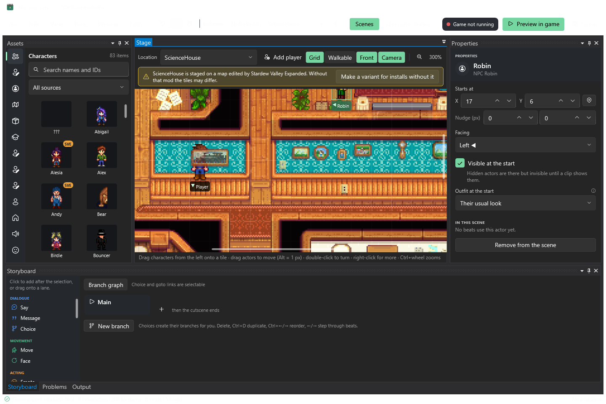
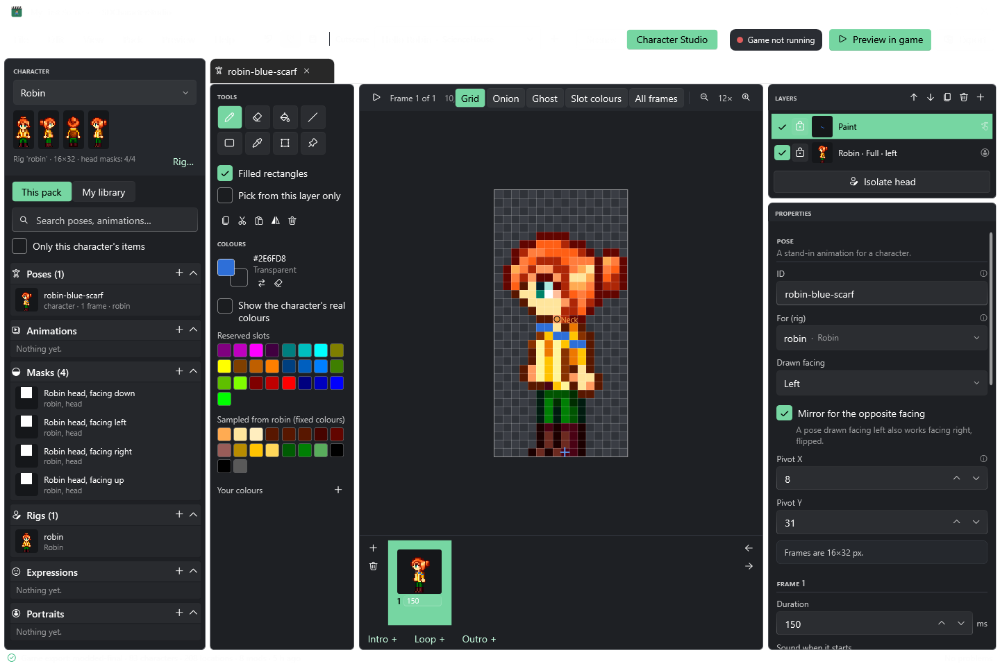
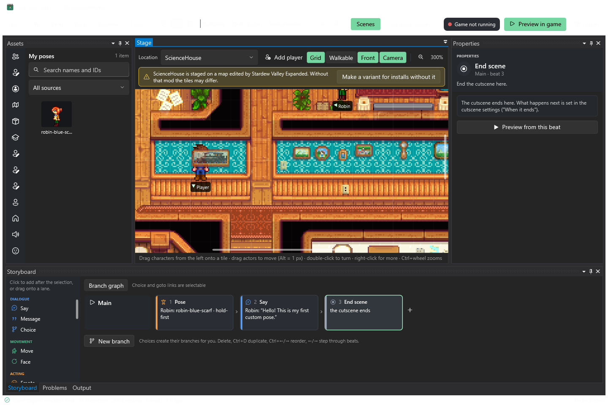

# Your first cutscene: Robin's blue scarf

Make a small custom pose, have Robin say one line, and export a finished mod. You use **Pose → Say → End scene**, without editing JSON or code. Allow about 45 minutes for this exercise; the fresh-person timing check is listed at the end.

## Get ready

1. Install [SMAPI](https://smapi.io/) and Stardew Valley. Follow [Installation](installation.md) to build the Windows editor and optional desktop shortcut. Launch `bin/Editor/SDCharacterStudio.Editor.exe`.
2. For authoring, install the Runtime and Bridge from `bin/packages` into the game's `Mods` folder. Start the game and load a **test** save. The first time only, the Bridge exports your game's characters and art (at launch) and maps (at the first save load); the game may pause now and then until it reaches 100%. The editor loads the export by itself when it's done. It never exports again by itself; after adding mods, use **Preview › Ask the game to export again**. See [Bridge setup](bridge-preview.md) if the catalog is empty.
3. Before starting, the asset browser should show Robin and the location picker should include **ScienceHouse**. If the stage says the export has no maps, load a save and let the map export reach 100%. Art can differ with sprite mods; the examples below use SCC and SVE.

You can close the game while drawing. Reopen the test save for in-game preview. The exported mod your players install contains its own engine; the Bridge is an authoring tool.

## 1. Make a project and place Robin

Choose **File → New project**. Name it **My First Scene**, give the first cutscene the title **Hello Robin**, and choose **ScienceHouse**. In Advanced, use your own unique mod ID, such as `YourName.FirstScene`. Create it in a folder you can find again.

In **Scenes**, find Robin in **Characters** and drag her to tile **(17, 6)**. Select her and set **Facing** to **Left**. Keep the player who was added by New project. Save with **Ctrl+S**.

If SVE is installed, the map-edit banner is expected: the scene is staged on that version of the map. For a first test, use the same mods when playing. The [editor guide](editor-guide.md#4-staging) explains variants for other installs.

## 2. Draw the scarf over a live sprite

Switch to **Character Studio**, choose **Robin**, and click **+** on the **Poses** shelf. Name the pose **blue-scarf**. The editor prefixes its ID with the character (`robin-blue-scarf`). A live standing frame appears; keep this layer so the pose follows the player's sprite mods.

Choose a blue colour (the screenshot uses `#2E6FD8`). Select the rectangle tool, turn on **Filled rectangles**, and draw a small band below the neck. On the 16×32 canvas, the example runs from pixel **(5, 16)** to **(10, 18)**. Drawing on the live layer creates a separate **Paint** layer above it. You should still see Robin's original face and hair.

Leave this as one frame. You can undo the whole stroke with **Ctrl+Z** and redraw it. Save again. For a completely new body that keeps the real head, try **Isolate head** after finishing this exercise; [Character Studio](editor-guide.md#11-character-studio-m8) explains masks, slots, anchors and animation.

## 3. Build three beats

Switch back to **Scenes**. Choose **My poses** in the asset browser and select your scarf pose, then click **Use**. In the new Pose beat's Properties, choose **Who: Robin** and **Play: Hold the first frame**.

Click **Say** in the storyboard palette. Set **Speaker: Robin** and **Line: Hello! This is my first custom pose.** Commit the text with **Ctrl+Enter**. Add **End scene** from the palette. The main lane should now contain exactly these three cards:

1. **Pose** — Robin, `robin-blue-scarf`, hold-first.
2. **Say** — Robin's line.
3. **End scene**.

If **Problems** reports an error, double-click it and fix the named field. Warnings explain things such as map edits; red errors block export. Save.

## 4. Preview and export

**When does it play?** Click an empty spot on the stage to see the scene's settings. A new scene plays **by itself** the first time the player walks into its location (here, Robin's house, `ScienceHouse`). Leave it like that for this exercise. Later you can add conditions there, such as a time, a season, a friendship level or a story flag, so the scene comes at the right moment.

With the game running on the test save and the Bridge light showing **Game ready**, press **F5** from **Scenes**. Switch to the game. Robin should wear the blue band while her dialogue is open. Close the dialogue; the scene ends and Robin returns to her normal look. **Ctrl+F5** stops a preview early.

Choose **Export** (**Ctrl+E**), leave **What players install: Just this mod**, and export. Click **Open folder**. The folder (`Export/My First Scene`, next to your project) contains `manifest.json`, your mod's named DLL, `studio.json`, and your scene/pose/art files. Share this exported folder or its zip, not the `.sdcs` project or its `.media` cache. Players need SMAPI and any mods listed as dependencies; they do **not** install SDCharacterStudio separately for this export mode.

To play it as a player would, put that folder in the game's `Mods` folder, restart the game, and walk into Robin's house. If you still have the Runtime installed for authoring, that's fine: the two don't clash.

Keep the project and source pack for future edits. [The modder guide](modder-guide.md) covers C# integration and the optional framework content-pack mode.

## If something looks wrong

| Symptom | What to check |
|---|---|
| No Robin or map | Load a test save and let the one-time Bridge export reach 100%; the editor picks it up. |
| Pose missing from My poses | Save the pose, return to Scenes, select My poses and clear the search. |
| Wrong character plays the pose | Select the Pose card and set Who to Robin. |
| Preview does not start | Close game menus, finish other events, wait for Game ready, then read Output. Event Limiter can block it. |
| Changed art after exporting | Live art follows installed sprite mods; only your painted scarf is stored in the pack. |
| Export error | Double-click the red problem; use an empty output folder or this project's earlier export. |
| Export says a scene doesn't play by itself | Click **Show me** and set **When does it play?** to **By itself**. Otherwise only another mod could start that scene. |
| Exported mod installed, but the scene never plays | Walk into the scene's location; a scene plays once per save. Check its conditions under **When does it play?**. |

## Fresh-person check

Start a timer after the game/catalog setup. Ask someone unfamiliar with the editor to follow this page without JSON/code help. Record elapsed time, the three-beat export, whether preview showed the pose and restored Robin, and any step where they needed help. M9's acceptance target is **under one hour**. The automated scenario test checks the same editor actions and exported files; it does not establish a human's completion time.
